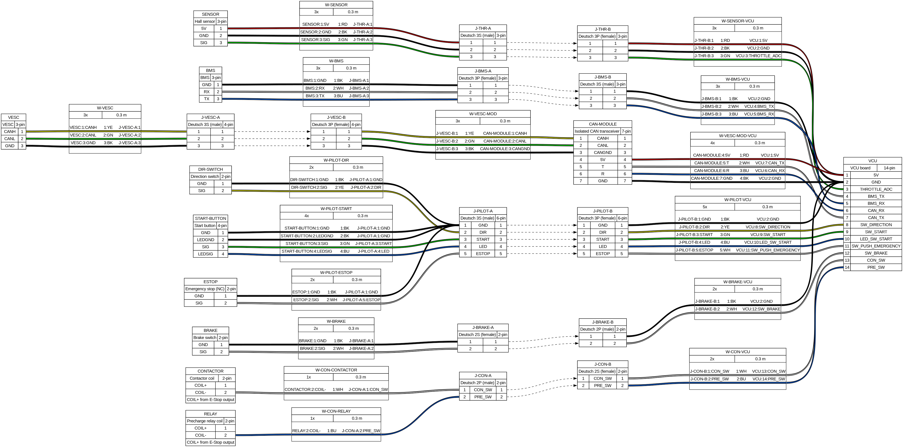

# Wiring

## Images
### Signal wiring

## Wire color code
 
| Color | Meaning |
| --- | --- |
| Red | (5 V, or 48 V) |
| Black | Ground |
| White, blue, green, yellow | Signals |
| Yellow + green | CAN (CANH yellow, CANL green) |
 
## Connector summary
 
| ID | Type | To |
| --- | --- | --- |
| J-BMS | DT 3-pin | BMS |
| J-THR | DT 3-pin | Throttle |
| J-CAN | DT 4-pin | VESC |
| J-PIL | DT 6-pin | Pilot |
| J-CON | DT 2-pin | Control (contactor and precharge) |
| J-BRK | DT 2-pin | Brake |
 
## J-BMS (3-pin): BMS UART
Male on VCU, female on BMS
| Pin | Signal | Color | STM32 pin |
| --- | --- | --- | --- |
| 1 | GND | Black | GND |
| 2 | VCU TX to BMS RX | White | BMS_TX |
| 3 | BMS TX to VCU RX | Blue | BMS_RX |
 
## J-THR (3-pin): Throttle
Female on VCU, male on Throttle
| Pin | Signal | Color | STM32 pin |
| --- | --- | --- | --- |
| 1 | 5 V | Red | 5 V |
| 2 | GND | Black | GND |
| 3 | Signal | Green | THROTTLE_ADC |
 
## J-CAN (4-pin): VESC CAN
Female on VCU, male on VESC
| Pin | Signal | Color |
| --- | --- | --- |
| 1 | CANH | Yellow |
| 2 | CANL | Green |
| 3 | GND | Black |
| 4 | Spare | |
 
## J-PIL (6-pin): pilot
 
Female on VCU, male on pilot
 
| Pin | Signal | Color | STM32 pin |
| --- | --- | --- | --- |
| 1 | GND | Black | GND |
| 2 | Direction switch | Yellow | SW_DIRECTION |
| 3 | Start button | Green | SW_START |
| 4 | Start LED | Blue | LED_SW_START |
| 5 | EStop | White | SW_PUSH_EMERGENCY |
| 6 | Spare | | |

## J-BRK (2-pin): Brake
 
Male on VCU, female on brake

| Pin | Signal | Color | STM32 pin |
| --- | --- | --- | --- |
| 1 | GND | Black | GND |
| 2 | Brake switch | White | SW_BRAKE |
 
## J-CON (2-pin): Control
 
Female on VCU, male on control
 
| Pin | Signal | Color |
| --- | --- | --- |
| 1 | Contactor mosfet output | White |
| 2 | Precharge mosfet output | Blue |